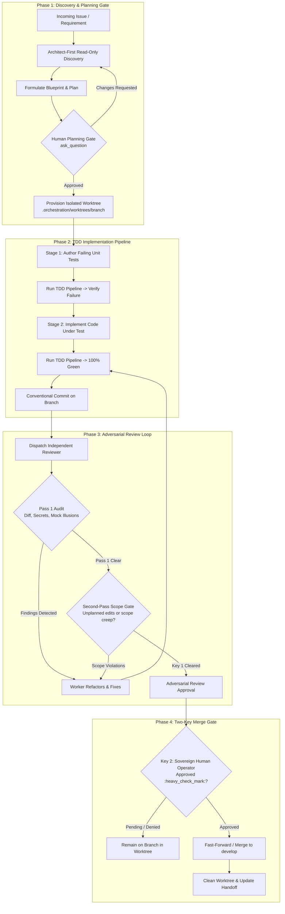

# agent-harness

**Canonical Unified Multi-CLI Agent Harness & Polymorphic Multi-Agent Orchestration Framework**

[](LICENSE)
[](pyproject.toml)
[](docs/unified_architecture.md)
[](docs/sglang-inference-stack.md)
[](config/systemd)

---

## 1. Architectural Overview

`agent-harness` is the canonical, enterprise-grade multi-agent runtime and orchestration engine designed to unify autonomous development workflows across disparate CLI ecosystems: **Google Antigravity**, **Anthropic Claude Code**, and **OpenCode (SGLang)**.

Rather than maintaining fragmented scripts, skills, and configuration rules across separate repositories, `agent-harness` establishes a **single authoritative source of truth**:
- **Polymorphic Memory Engine**: Combines CPU-accelerated ColBERTv2 late-interaction neural search over Obsidian knowledge vaults with RadixAttention prefix caching and standardized markdown task handoffs.
- **Dynamic Runtime Adapters**: Pluggable adapters (`AgyRuntimeAdapter`, `ClaudeRuntimeAdapter`, `OpenCodeRuntimeAdapter`) seamlessly translate unified agent charters, tools, and rules into engine-native schemas.
- **Master Universal Installer**: Atomic manifest-driven installer and uninstaller supporting global and localized repository deployments with cryptographic SHA-256 rollback protection.
- **Local SGLang Backend Parity**: Turnkey systemd user service deployment for high-throughput local LLM serving, automatic GPU hardware probing, cgroup agent slicing, and OOM watchdog recovery.

```
agent-harness/
├── harness/                      # Canonical Python package
│   ├── installer/                # Atomic manifest engine, settings mergers, and hash verifiers
│   ├── memory/                   # Polymorphic memory, ColBERTv2 MaxSim engine, context anchors
│   ├── runtime/                  # Dynamic engine adapters (agy, claude, opencode)
│   ├── mcp/                      # FastMCP tool servers (vault-memory, worktree-manager, tool-runner)
│   ├── orchestrator/             # State machine, routing, escalation & recovery
│   └── security/                 # Red team perimeter guards, secret broker
├── templates/
│   ├── shared/                   # Canonical rules & skills across all engines
│   │   ├── rules/                # agent-teams.md, code-quality.md, git-workflow.md, process-safety.md
│   │   └── skills/               # 7 canonical skills (adversarial-review, context-anchoring, etc.)
│   ├── agy/                      # Google Antigravity manifest & Gemini 3.8 charters
│   ├── claude/                   # Claude Code agent profiles & JSON settings
│   └── opencode/                 # OpenCode agents, slash commands, opencode.json & blackwell theme
├── scripts/                      # Autonomous operational tools (gpu_probe, worktree_manager, tdd_pipeline)
├── config/
│   ├── systemd/                  # 21 SGLang model services, opencode-server, slice, and timers
│   ├── models/                   # Universal model catalog mapping backends to hardware targets
│   └── sysctl/                   # Linux kernel ML tuning profiles
├── vault/                        # Obsidian-compatible entity knowledge vault
├── docs/                         # Architectural specifications, governance, and memory designs
└── tests/                        # 147 unit tests and 11 shell regression test suites
```

---

## 2. Quick Start & Installation

The universal installer (`install.sh`) provisions plugins, charters, skills, systemd user services, and settings with fine-grained target and mode selection.

### Installation Targets and Modes

| Command | Target | Mode | Deployed Components |
| :--- | :--- | :--- | :--- |
| `./install.sh --target all` | All Engines | Global | Antigravity plugins, Claude Code agents/settings, OpenCode hierarchy, SGLang user units |
| `./install.sh --target agy` | Antigravity | Global | `~/.orchestration/`, `~/.agents` symlink, `~/.gemini/config/plugins/agent-harness` |
| `./install.sh --target claude` | Claude Code | Global | `~/.claude/` (agents, rules, skills, tools, and merged `settings.json`) |
| `./install.sh --target opencode` | OpenCode | Global | `~/.config/opencode/`, `~/.config/opencode-backends/`, `~/.config/systemd/user/` units |
| `./install.sh --local [path]` | Targeted | Local Repo | Sandboxed deployment into targeted repository with `.gitignore` protections |
| `./install.sh --local --systemd` | OpenCode | Local Repo | Deploys local `.opencode/` plus systemd user services to user session |

### Detailed Installation Commands

#### 1. Full Multi-Runtime Deployment (Global)
```bash
# Deploys Antigravity, Claude Code, and OpenCode with SGLang systemd user units
./install.sh --target all --global --non-interactive
```

#### 2. OpenCode Full Backend & SGLang Deployment
```bash
# Probes host GPU, deploys models_catalog, and installs systemd user service units
./install.sh --target opencode --global

# Force a specific GPU profile during installation:
./install.sh --target opencode --override-gpu rtx-5090
```

#### 3. Local Repository Sandboxed Installation
```bash
# Installs unified operational assets into targeted repository without touching home directory
./install.sh --target all --mode local /path/to/target-repo
```

#### 4. Cryptographic Manifest Verification
All installations generate an atomic manifest (`install_manifest.json`) recording absolute file paths, symlinks, directories, and SHA-256 hashes.
```bash
# Verify integrity of global installation
./install.sh --verify --mode global

# Verify integrity of a local repository installation
./install.sh --verify --mode local /path/to/target-repo
```

#### 5. Non-Destructive Rollback & Uninstallation
Uninstallation uses the atomic manifest engine to roll back deployed files in reverse order:
- **User Modification Preservation**: Any file modified by the user after installation is preserved; the uninstaller emits a warning rather than deleting user work.
- **Settings & Backup Restoration**: Pre-existing configuration files (e.g., `settings.json.pre-harness.bak`, `.agents.pre-harness.bak`) are atomically restored.
- **Service Teardown**: Systemd user units are stopped, disabled, unlinked, and followed by `systemctl --user daemon-reload`.
```bash
# Safely remove global harness files, preserving user changes and backend venvs
./uninstall.sh

# Complete purge including backend virtual environments and caches
./uninstall.sh --purge -y

# Remove local repository harness assets
./uninstall.sh --local /path/to/target-repo -y
```

---

## 3. Multi-Agent Architecture

`agent-harness` implements a strictly separated, two-tier hierarchical multi-agent architecture where responsibilities, permissions, and tool access are enforced at runtime.

```
                    ┌──────────────────────────────┐
                    │    Supreme Orchestrator      │
                    │   (System Coordinator / L1)  │
                    └──────────────┬───────────────┘
                                   │ delegates 1:1
                                   ▼
                    ┌──────────────────────────────┐
                    │      Team Orchestrator       │
                    │   (Per-Issue Coordinator/L2) │
                    └──────────────┬───────────────┘
                                   │ spawns & coordinates
         ┌─────────────────────────┼─────────────────────────┐
         ▼                         ▼                         ▼
┌──────────────────┐      ┌──────────────────┐      ┌──────────────────┐
│    architect     │      │      worker      │      │      tester      │
│ (Discovery/Plan) │      │  (Implementation)│      │  (TDD Pipeline)  │
└────────┬─────────┘      └────────┬─────────┘      └────────┬─────────┘
         │                         │                         │
         │ delegates               ├───────────┐             │ delegates
         ▼                         ▼           ▼             ▼
┌──────────────────┐      ┌──────────────┐ ┌──────────────┐ ┌──────────────┐
│      scout       │      │    scout     │ │    grunt     │ │    scout     │
│  (Read-Only Search)│    │(Read-Only Srch)│ (Atomic Edit)│ │(Read-Only Srch)│
└──────────────────┘      └──────────────┘ └──────────────┘ └──────────────┘
                                   ▲
                                   │ audits
                          ┌────────┴─────────┐
                          │     reviewer     │
                          │(Adversarial Gate)│
                          └────────┬─────────┘
                                   │ delegates
                                   ▼
                          ┌──────────────────┐
                          │      scout       │
                          └──────────────────┘
```

### Two-Tier Orchestration Hierarchy

1. **Supreme Orchestrator (System Coordinator / L1)**:
   - Primary human-facing interface.
   - Triages incoming feature requests, bug reports, and issue specifications.
   - Executes Architect-First read-only discovery before formulating plans.
   - Submits plans to the Human Operator and awaits explicit approval via `ask_question`.
   - Spawns at most **one** per-issue `team-orchestrator`.
   - *Invariants*: Never modifies code, never spawns leaves directly, never runs tests, and never merges.

2. **Team Orchestrator (Per-Issue Coordinator / L2)**:
   - Provisions isolated git worktrees at `.orchestration/worktrees/<branch>`.
   - Dispatches and coordinates the 6 specialist leaf agents.
   - Drives the implementation lifecycle through the Two-Stage TDD pipeline.
   - Coordinates the Automated Adversarial Review Loop.
   - *Invariants*: Never reviews its own code, never edits repository files, and never bypasses human merge gates.

### The 6 Specialist Leaves

| Agent | Tier | Role & Responsibilities | Permitted Tools | Forbidden Actions |
| :--- | :--- | :--- | :--- | :--- |
| **`architect`** | High | Systems architecture, codebase surveys, refactor blueprints, dependency mapping. | Read-only inspection, `scout` | File edits, writes, shell execution, commits |
| **`worker`** | Medium | Discrete code implementation, refactoring, test authoring, Conventional Commits. | File edits, commands, `grunt`, `scout` | Direct PR merges, force pushes, self-review |
| **`tester`** | Medium | Two-Stage TDD pipeline execution, reproduction of test failures, mock-illusion hunting. | Test execution, diagnostics, `grunt`, `scout` | Production commits without worker coordination |
| **`reviewer`** | Medium | Adversarial code review, security audits, secret leak scanning, Second-Pass Scope Gate. | Read-only inspection, diff analysis, `scout` | Code modifications, commits, PR approval bypass |
| **`scout`** | Low | Ultra-fast read-only search leaf (grep, AST traversal, file discovery, context compaction). | Grep, ripgrep, file viewing, find_by_name | Any file write, process mutation, or edit |
| **`grunt`** | Low | Ultra-fast atomic edit & syntax check leaf (localized refactors, mechanical fixes, lint checks). | Targeted string replacement, linter checks | Multi-file architectural refactoring, commits |

### Model Tier Allocation Matrix

| Role | Antigravity Runtime (Gemini 3.8) | Claude Code Runtime (Anthropic) | OpenCode Runtime (Local SGLang) | OpenCode Cloud Fallback |
| :--- | :--- | :--- | :--- | :--- |
| **Supreme Orchestrator** | `gemini-3.8-flash-high` (`pro`) | `claude-3-7-sonnet` (Thinking) | `ornith-1.5-35b` (MoE) | `claude-3-7-sonnet` / `gemini-2.5-pro` |
| **Team Orchestrator** | `gemini-3.8-flash-high` (`pro`) | `claude-3-7-sonnet` (Thinking) | `ornith-1.5-35b` (MoE) | `claude-3-7-sonnet` / `gemini-2.5-pro` |
| **Architect** | `gemini-3.8-flash-high` (`pro`) | `claude-3-7-sonnet` (Thinking) | `ornith-1.5-35b` (MoE) | `claude-3-7-sonnet` / `gemini-2.5-pro` |
| **Worker** | `gemini-3.8-flash-medium` (`flash`) | `claude-3-7-sonnet` | `ornith-1.5-35b` (MoE) | `claude-3-7-sonnet` / `gemini-2.5-pro` |
| **Tester** | `gemini-3.8-flash-medium` (`flash`) | `claude-3-7-sonnet` | `ornith-1.5-35b` (MoE) | `claude-3-7-sonnet` / `gemini-2.5-pro` |
| **Reviewer** | `gemini-3.8-flash-medium` (`flash`) | `claude-3-7-sonnet` (Adversarial) | `ornith-1.5-35b` (MoE) | `claude-3-7-sonnet` / `gemini-2.5-pro` |
| **Scout** | `gemini-3.8-flash-low` (`flash_lite`) | `claude-3-5-haiku` | `ornith-1.5-9b` (Fast) | `claude-3-5-haiku` / `gemini-2.5-flash` |
| **Grunt** | `gemini-3.8-flash-low` (`flash_lite`) | `claude-3-5-haiku` | `ornith-1.5-9b` (Fast) | `claude-3-5-haiku` / `gemini-2.5-flash` |

---

## 4. Execution & Governance Lifecycle

Development in `agent-harness` follows a non-negotiable four-phase governance lifecycle designed to prevent unreviewed code from reaching production branches.



### Governance Principles

1. **Worktree Isolation**:
   - The local repository root must remain checked out on `develop`.
   - Feature and fix development occurs strictly inside `.orchestration/worktrees/<branch>` provisioned via `scripts/worktree_manager.py`.
2. **Two-Stage TDD Pipeline**:
   - *Stage 1*: Author unit tests reproducing the issue or defining required behavior; verify failure.
   - *Stage 2*: Implement discrete changes; run tests until 100% green without regressions.
3. **The Two-Key Merge Gate**:
   - **Key 1 (Automated Adversarial Review Approval)**: An independent `reviewer` agent audits the full pull-request diff. The reviewer inspects for mock illusions, hardcoded secrets, scope creep, and untested edge cases.
   - **Key 2 (Human Sovereign Operator Approval)**: The human operator must explicitly issue formal approval (`Approved :heavy_check_mark:`). No automated agent may simulate or forge human approval.
4. **Orchestrator Non-Termination Invariant**:
   - Subagents, leaf agents, and workers must **never** kill or terminate `supreme-orchestrator` or `team-orchestrator`.
   - System commands (`kill`, `pkill`, `killall`) and agent lifecycle APIs (`manage_subagents kill`) targeting orchestrators are strictly prohibited.
5. **Canonical `.orchestration/` Filesystem Standard**:
   - Inter-session handoffs, memory indices, logs, and worktrees are stored under `.orchestration/`.
   - This convention enables Antigravity, Claude Code, and OpenCode to interchange tasks and handoffs day-to-day without data loss or environment lock-in.

---

## 5. Hardware & Backend Architecture (Local SGLang)

OpenCode is powered by a high-throughput, local SGLang inference backend running directly on host GPUs with zero external dependencies.

### Local SGLang Inference Stack

```
+-----------------------------------------------------------------------------------+
| Host Hardware: NVIDIA RTX 5090 / RTX PRO 6000 / RTX Spark (NVFP4 Compute)         |
+-----------------------------------------+-----------------------------------------+
                                          |
                      +-------------------+-------------------+
                      | SGLang Inference Engine (Port 30000)  |
                      | - RadixAttention prefix tree cache   |
                      | - Native FP8 / NVFP4 KV cache         |
                      | - Chunked prefill (2048 tokens)       |
                      | - OpenAI-compatible HTTP direct API   |
                      +-------------------+-------------------+
                                          |
          +-------------------------------+-------------------------------+
          |                                                               |
+---------v---------------------------+         +-------------------------v---------+
| opencode-server.service (Port 4096) |         | opencode-agent.slice (Cgroup v2)  |
| - Headless remote web/TUI server    |         | - CPUWeight=200, IOWeight=200     |
| - Token & password authenticated    |         | - MemoryHigh=24G, MemoryMax=28G   |
| - OpenCode Mobile client endpoint   |         | - Protects SGLang KV from OOM     |
+-------------------------------------+         +-----------------------------------+
```

- **RadixAttention & KV Cache Reuse**: Retains prompt prefixes across multi-turn subagent execution in a radix tree, reducing time-to-first-token (TTFT) by up to 85% during iterative file reviews and test runs.
- **NVFP4 Precision & Triton GDN Kernels**: Model weights and activations utilize NVFP4 quantization, allowing 35B and 70B parameter models to fit comfortably within single-card consumer and workstation VRAM budgets.
- **Systemd User Units (`~/.config/systemd/user/`)**:
  - `opencode-server.service`: Headless remote server exposing port 4096 with password authentication.
  - `opencode-agent.slice`: Cgroup resource isolation preventing background compilation or indexing from starving inference.
  - `opencode-colbert-reindex.service` & `timer`: Hourly scheduled CPU-only reindexing of Obsidian knowledge vaults.
  - `opencode-sglang-ornith-35b.service`: Primary SGLang model server on `127.0.0.1:30000`.

### Dynamic GPU Probing (`scripts/gpu_probe.sh`)

During installation, `scripts/gpu_probe.sh` dynamically inspects the host GPU via `nvidia-smi` and outputs tuned KV cache parameters:

```bash
# Probed profile output format:
{"profile":"rtx-5090","memory_fraction":0.88,"max_context":262144,"kv_cache_dtype":"nvfp4","offload":"pure-gpu","gpu":"NVIDIA GeForce RTX 5090 (32GB)"}
```

| Profile | Target VRAM | Static Memory Fraction | Max Context Length | Default Service Unit |
| :--- | :--- | :--- | :--- | :--- |
| `rtx-5090` | ~32 GB | `0.88` | 262,144 tokens (256k) | `opencode-sglang-ornith-35b.service` |
| `rtx-pro-6000` | ~48–96 GB | `0.90` | 262,144 tokens (256k) | `opencode-sglang-ornith-35b.service` |
| `rtx-spark` | ~128 GB Unified | `0.92` | 512,000 tokens (512k) | `opencode-sglang-ornith-35b.service` |
| `fallback` | Generic (>=32 GB) | `0.88` | 262,144 tokens (256k) | `opencode-sglang-ornith-35b.service` |

### SGLang OOM Watchdog Recovery (`scripts/sglang_oom_handler.sh`)

If extreme context lengths trigger a CUDA Out-Of-Memory condition, systemd user services trigger `sglang_oom_handler.sh` as an `ExecStopPost=` hook:
1. Detects exit status and parses the journal for CUDA memory allocations.
2. Degrades the context floor monotonically: `262144` -> `131072` -> `65536` -> `32768`.
3. Records the updated limit in `~/.config/opencode-backends/context_length.state`.
4. Automatically restarts the service with reduced memory pressure.

### Cloud API Fallback Configuration

When local GPU acceleration is offline or large-context reasoning exceeds local memory budgets, OpenCode automatically falls back to configured cloud endpoints:
- **Fallback Providers**: Defined in `opencode.json` for Anthropic (`claude-3-7-sonnet`, `claude-3-5-haiku`) and Google (`gemini-2.5-pro`, `gemini-2.5-flash`).
- **Secure Credentials**: API tokens (`ANTHROPIC_API_KEY`, `GEMINI_API_KEY`, `OPENAI_API_KEY`, `HF_TOKEN`) are loaded from `~/.config/opencode-backends/env` with strict `0600` permissions.

---

## 6. Polymorphic Memory & ColBERTv2 Engine

`agent-harness` features a CPU-first semantic retrieval engine based on ColBERTv2 late-interaction scoring:

- **Zero GPU Contention**: Neural MaxSim token matching runs exclusively on CPU via ONNX Runtime (`onnxruntime`), leaving 100% of GPU VRAM allocated to model inference.
- **Obsidian Vault Compatibility**: Directly indexes markdown knowledge vaults located in `vault/` (entities, concepts, guides, architectural decisions).
- **FastMCP Tool Server (`vault-memory`)**: Exposes `colbert_retrieve` over the Model Context Protocol (FastMCP) with strict JSONSchema Draft 2020-12 compliance.

---

## 7. Verification & Testing

The repository maintains an automated two-layer verification suite:

### 1. Python Unit & Integration Suite (147 Tests)
```bash
# Run the complete test suite with uv
uv run --with pytest pytest
```
Covers installer rollbacks, settings mergers, ColBERT MaxSim scoring, context anchors, handoffs, FastMCP tool servers, state machine transitions, secret perimeter brokers, and worktree isolation.

### 2. Shell Regression Test Suites (11 Suites)
```bash
# Run all shell regression suites
for t in tests/*.sh; do bash "$t" && echo "PASS: $t"; done
```
Verifies systemd unit syntax, SGLang CLI parser configs, OOM watchdog context ladders, network boundary isolation on port 30000, uninstaller scoping, and non-interactive installation safety.

---

## 8. License

This project is licensed under the terms of the **GNU Affero General Public License v3.0** ([AGPL-3.0](LICENSE)).
