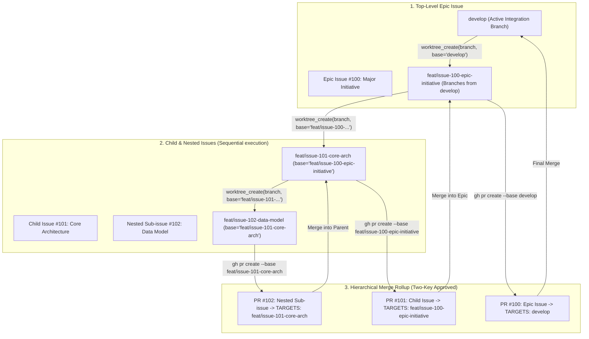

# Unified Multi-Runtime Agent Harness Architecture (SSOT)

## 1. Architectural Overview & Single Source of Truth (SSOT)

`agent-harness` is the authoritative, multi-runtime agent harness providing unified orchestration across three coding-agent runtimes:
1. **OpenCode (`opencode` / `sst/opencode`)**: Terminal and headless agent execution powered by local SGLang MoE inference (`ornith-1.5-35b` / `ornith-1.5-9b`).
2. **Anthropic Claude Code (`claude`)**: CLI-based agent orchestration powered by Claude models (`opus`, `sonnet`, `haiku`).
3. **Google Antigravity (`agy`)**: Agentic IDE and CLI orchestration powered by Google Gemini 3.8 models (`gemini-3.8-flash-high`, `gemini-3.8-flash-medium`, `gemini-3.8-flash-low`).

All prose, agent profiles, modular rules, skills, and slash commands are consolidated into a canonical Single Source of Truth under `core/`:

```text
agent-harness/
├── core/
│   ├── CHARTER.md            # Single authoritative master system prompt
│   ├── manifest.json         # Logical tiers, roles, tool access, permissions
│   ├── rules/                # 5 canonical modular rules
│   │   ├── git-workflow.md
│   │   ├── agent-teams.md
│   │   ├── code-quality.md
│   │   ├── process-safety.md
│   │   └── systems-integration.md
│   ├── skills/               # 7 canonical skills
│   │   ├── adversarial-review/
│   │   ├── context-anchoring/
│   │   ├── read-only-block/
│   │   ├── sglang-management/
│   │   ├── tdd-pipeline/
│   │   ├── vault-retrieval/
│   │   └── worktree-lifecycle/
│   ├── commands/             # 7 canonical slash commands (.md)
│   │   ├── colbert.md
│   │   ├── escalate.md
│   │   ├── handoff.md
│   │   ├── reindex.md
│   │   ├── review.md
│   │   ├── test.md
│   │   └── worktree.md
│   └── agents/               # 8 canonical agent role definitions (.md)
│       ├── supreme-orchestrator.md
│       ├── team-orchestrator.md
│       ├── architect.md
│       ├── worker.md
│       ├── tester.md
│       ├── reviewer.md
│       ├── scout.md
│       └── grunt.md
├── harness/                  # Python FastMCP servers & runtime orchestration
│   ├── mcp/
│   │   ├── vault_server.py    # Obsidian + ColBERT (vault-memory) FastMCP
│   │   └── worktree_server.py # Git Worktree Manager (worktree-manager) FastMCP
│   └── installer/
│       ├── compiler.py       # Deterministic subagent frontmatter compiler
│       ├── config_sync.py    # Multi-runtime JSON & markdown sync
│       ├── manifest.py       # Install state ledger & verification engine
│       └── settings.py       # Claude Code JSON settings merger
├── scripts/                  # CLI utilities (worktree_manager.py, tdd_pipeline.py, etc.)
└── install.sh                # Idempotent universal compiler & symlink installer
```

---

## 2. Multi-Runtime Loading Mechanics

```mermaid
flowchart TD
    subgraph SSOT["Single Source of Truth (core/)"]
        Charter["core/CHARTER.md"]
        Rules["core/rules/*.md (5 rules)"]
        Skills["core/skills/* (7 skills)"]
        Commands["core/commands/*.md (7 commands)"]
        Agents["core/agents/*.md (8 roles)"]
        Manifest["core/manifest.json"]
    end

    Compiler["harness/installer/compiler.py"]
    ConfigSync["harness/installer/config_sync.py"]
    Installer["install.sh"]

    Manifest --> Compiler
    Agents --> Compiler
    Charter --> ConfigSync
    Rules --> ConfigSync

    Compiler -->|"Compile OpenCode frontmatter"| OpenCodeAgents["~/.config/opencode/agents/"]
    Compiler -->|"Compile Claude frontmatter"| ClaudeAgents["~/.claude/agents/"]
    Compiler -->|"Compile AGY frontmatter"| AGYAgents["~/.gemini/config/plugins/agent-harness/agents/"]

    ConfigSync -->|"instructions: [rules/*.md]<br/>agent: {compaction, summary}"| OpenCodeConfig["~/.config/opencode/opencode.json"]
    ConfigSync -->|"mcpServers: {vault-memory, worktree-manager}"| ClaudeConfig["~/.claude.json"]
    ConfigSync -->|"<!-- BEGIN AGENT-HARNESS -->"| GeminiMD["~/.gemini/GEMINI.md"]
    ConfigSync -->|"mcpServers: {vault-memory, worktree-manager}"| AGYConfig["~/.gemini/config/mcp_config.json"]

    Installer -->|"Symlink CHARTER.md -> AGENTS.md"| OpenCodeCharter["~/.config/opencode/AGENTS.md"]
    Installer -->|"Symlink CHARTER.md -> CLAUDE.md"| ClaudeCharter["~/.claude/CLAUDE.md"]
    Installer -->|"Symlink individual rules & skills"| OpenCodeRules["~/.config/opencode/rules/ & skills/"]
    Installer -->|"Symlink individual rules & skills"| ClaudeRules["~/.claude/rules/ & skills/"]
    Installer -->|"Symlink individual skills"| AGYSkills["~/.gemini/config/skills/"]
```



### 2.1 OpenCode Runtime (`sst/opencode`)
- **Master Charter**: `~/.config/opencode/AGENTS.md` (symlinked from `core/CHARTER.md`). OpenCode natively auto-discovers this file at startup.
- **Supplemental Instructions**: `instructions` array in `opencode.json` contains strictly `["~/.config/opencode/rules/*.md"]`. `AGENTS.md` is never listed in `instructions`, preventing duplicate context ingestion.
- **Subagents (`agents/`)**: 8 compiled markdown definitions (`mode: primary` for `supreme-orchestrator`; `mode: subagent` for `team-orchestrator`, `architect`, `worker`, `tester`, `reviewer`, `scout`, `grunt`).
- **System Agents**: `compaction`, `summary`, and `title` are configured directly under the `"agent"` key in `opencode.json` (routed to `ornith-local/ornith-1.5-9b`). They are excluded from `agents/` to prevent collisions with OpenCode's hidden built-in primary agents.
- **MCP Schema**: OpenCode uses `"mcp"`, `"type": "local"`, flat array `"command"`, and `"environment"`.

### 2.2 Claude Code Runtime (`anthropic`)
- **Master Charter**: `~/.claude/CLAUDE.md` (symlinked from `core/CHARTER.md`). Contains zero inline `@rules` imports, preventing duplicate ingestion with Claude Code's native auto-discovery of `~/.claude/rules/*.md`.
- **Subagents (`agents/`)**: Emits `name`, `description`, `model` (`opus`, `sonnet`, `haiku`), and `tools` (e.g. `Read, Grep, Glob, Bash` for read-only roles).
- **Settings & Hooks**: Permissions and `PreToolUse` safety hooks are merged into `~/.claude/settings.json`.
- **MCP Schema**: Global user-scope MCP servers are merged into `~/.claude.json` under `"mcpServers"`.

### 2.3 Google Antigravity Runtime (`agy`)
- **Global Instructions**: Master Charter and modular rules are injected into `~/.gemini/GEMINI.md` wrapped between bounded markers (`<!-- BEGIN AGENT-HARNESS -->` and `<!-- END AGENT-HARNESS -->`), preserving user memories outside the block.
- **Plugin Integration**: Agent personas are compiled into `~/.gemini/config/plugins/agent-harness/agents/*.md`.
- **Skills**: Each skill is symlinked individually into `~/.gemini/config/skills/<skill>` and `~/.gemini/config/plugins/agent-harness/skills/<skill>`.
- **MCP Schema**: Registered in `~/.gemini/config/mcp_config.json` under `"mcpServers"`.

---

## 3. FastMCP Server Hardening

Both `vault-memory` and `worktree-manager` FastMCP servers enforce strict production invariants:

1. **Strict STDIO Stream Hygiene**:
   - `TOKENIZERS_PARALLELISM="false"`, `TQDM_DISABLE="1"`, `TRANSFORMERS_VERBOSITY="error"`.
   - Logging redirected strictly to `sys.stderr`.
   - Operational indexing and search calls wrapped in `contextlib.redirect_stdout(sys.stderr)` to guarantee zero non-JSON lines leak onto JSON-RPC `stdout`.
2. **Absolute Path Resolution**:
   - All paths resolved via `Path(...).expanduser().resolve()`: `HARNESS_ROOT`, `ORCHESTRATION_ROOT`, `OBSIDIAN_VAULT_PATH`, and `COLBERT_INDEX_PATH`.
   - Out-of-tree execution from arbitrary worktree directories functions without relative path errors.
3. **Obsidian Deduplication & File Locking**:
   - `save_distilled_decision` computes deterministic SHA-256 content hashes to prevent duplicate notes.
   - Concurrent writes protected by atomic rename (`.tmp` + `os.replace`) and `fcntl.flock` concurrency locking.
4. **Hierarchical Worktree Branching**:
   - `worktree_create(branch, base="develop")` supports branching from parent issue branches (`feat/issue-100-epic`), verifying local and remote `origin/<base>` refs before creating worktrees under `~/.orchestration/worktrees/<branch>`.

---

## 4. Hierarchical Epic & Nested Issue Workflow

All work across all runtimes follows a strict hierarchical branching, PR, and merging lifecycle:



### Workflow Invariants
1. **Branch Naming**: Strictly formatted as `<type>/issue-<number>-<description>`.
2. **Dedicated Branch & PR per Issue**: Every issue has a dedicated worktree and PR.
3. **Parent Base Targeting**: Child and nested branches branch from and target their parent issue's branch.
4. **Sequential Execution**: Nested issues are worked on one at a time.
5. **Rollup Merges**: Nested issues merge into their parent branch before the parent merges upward to `develop`.
